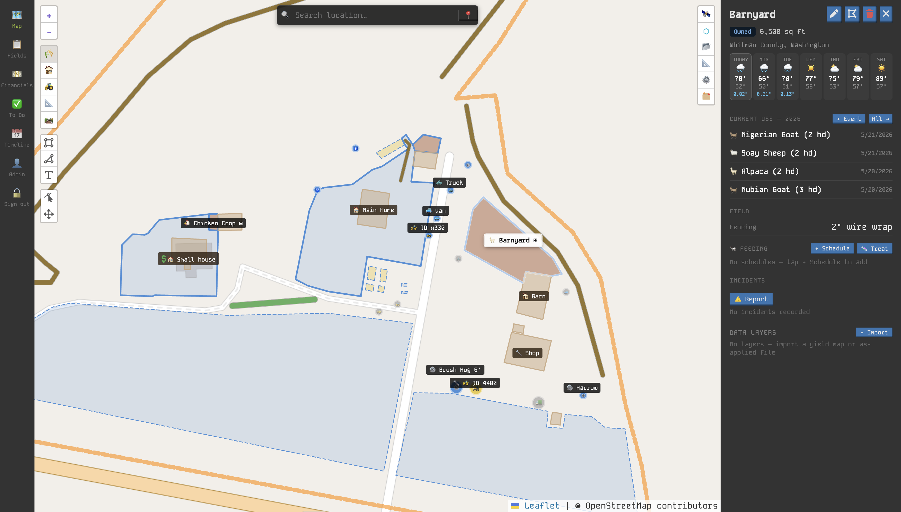

# Land Ledger

**Your farm, mapped and managed.** Land Ledger is a self-hosted app for farm operators who need to track everything — fields, leases, equipment, livestock, finances, compliance records, and events — tied to where it actually lives on the land.

No subscription. Your data stays on your machine.



---

## What it does

Most farm management tools treat your operation as a spreadsheet. Land Ledger treats it as a place. The map is the primary interface — you draw your fields, buildings, and paths directly onto satellite imagery, then attach everything else to those shapes.

Pull up a field and see its acreage, who's renting it, what was planted last season, how that yield compares to your county average, what the weather looked like that season, and what's coming up next. Every record is anchored to something real.

---

## Capabilities

**Map & fields** Draw and edit fields, buildings, equipment locations, paths, and parcels on an interactive map. Fields are color-coded by tenure and status at a glance. Acreage is calculated geodesically in your preferred unit.

**Leases & loans** Track who owns what, who's renting what, and for how long. Tenant and lessor roles, linked to specific fields or buildings. Outstanding loan balances and maturity dates surface in the To Do list and net worth snapshot.

**Equipment & maintenance** Registry of machinery with current hours and status. Log maintenance work, schedule upcoming service. Overdue and due-soon schedules surface in the To Do list automatically.

**Livestock**

- **Feeding schedules and logs** — tied to fields
- **Animal registry** — individual animal records with ear tag, species, breed, sex, birth date, parentage, and current field location
- **Health records** — vaccination and treatment records per animal with drug name, dose, route, and withdrawal period (calculated automatically from date + label days)
- **Breeding records** — dam/sire, breeding date, expected due date (auto-computed from species gestation period), and actual birth outcomes
- Withdrawal period compliance and upcoming births surface in the To Do list

**Supplies** Track what's on hand — quantity, cost per unit, and which building it's stored in.

**Timeline & events** A running log of activity across the whole operation — crop, livestock, harvest, cover crop, input, soil test, tillage, and observation events — filterable by field or category. Future-dated events are plans. Each season header in field view shows a weather summary and county yield benchmark comparison when data is available.

**Application logs (compliance)** Structured pesticide, herbicide, fungicide, and fertilizer records with EPA registration number, active ingredients, rate and unit, total applied, application method, target pest, re-entry interval (REI), pre-harvest interval (PHI), operator name and license number, and weather conditions at time of application. Exportable as CSV for audit submissions.

**Precision data layers** Import yield maps and as-applied maps from combine and planter monitors. Accepts CSV files with lat/lon columns (standard export from JD Operations Center, Climate FieldView, and most precision ag platforms) and GeoJSON with Point features. Up to 5,000 GPS points per layer stored with precomputed statistics (mean, standard deviation, coefficient of variation, quartiles). Layers render on the map as color-coded point clouds and can be displayed for any field in the panel.

**To Do** A live checklist generated from your data — maintenance schedules due, equipment in bad status, feeding overdue, lease renewals approaching, upcoming planned events, animals in active withdrawal periods, and expected births. Nothing to maintain separately.

**Weather** A 7-day forecast strip appears at the top of every field panel with danger-day highlighting (frost warnings in amber, hard freeze in purple, heavy rain in blue). Historical weather is cached locally from a public satellite archive — no API key required. App-wide frost, freeze, rain, and wind alerts appear as dismissible cards. The weather cache snaps to a 0.25° grid (~27 km), so all fields on a farm share one cache entry.

**County yield benchmarks (optional)** When a USDA NASS API key is configured, the Timeline shows how your recorded yield per acre compares to the county average for the same crop and season. Free key registration at [quickstats.nass.usda.gov/api](https://quickstats.nass.usda.gov/api). Results are cached indefinitely for historical seasons.

**Cross-field analytics** The Financials view shows field-level P/L including cash rent, per-acre net, and year-over-year trend for every field. A season comparison matrix shows net P/L by field across up to five seasons at a glance — answering "which fields made money and which didn't."

**Finances** Revenue records by source, recurring budget line items (rent, insurance, subscriptions), and season-scoped charts. Recurring lease costs are factored into the operation-level totals. Net worth snapshot includes equipment appraisals, property appraisals, and outstanding loan balances.

**Import** Import CSV or JSON files into any collection with a column mapper. Unmapped columns go into the free-form Properties bag automatically. Save column mappings as named templates for recurring sources (same lab, same platform). Import previously exported application records, soil tests, and supply inventory from any supported platform.

**Export** Export any collection as CSV or GeoJSON (map features), or generate a full JSON backup of everything. Template-matched exports produce a CSV whose columns match a saved import mapping exactly — making the export → edit → re-import cycle seamless.

**Shared access links** Generate time-limited, read-only, scoped links for auditors, certifiers, lenders, and crop consultants. Pre-built templates for organic/GAP certification (application records + field history), regulatory audit, lender packages, and crop consultant access. Each link renders a printable HTML report — no login required, token is the auth. Revocable at any time.

**Quick Log (mobile)** On mobile screens, a floating action button opens a bottom sheet. GPS fires immediately and detects which field or building you're standing in — the location selector is pre-filled, with one tap to switch to an adjacent or containing field. Log field events, pesticide/fertilizer applications, or quick observations without navigating the full map.

---

## Self-hosted and offline-first

Land Ledger runs as a local web server. Data is stored across several JSON files. All writes use a tmp-then-rename strategy — the server can crash mid-write without corrupting any file.

The default base path is `~/.landLedger.json`. All other filenames derive from it:

| File pattern | Contents |
| --- | --- |
| `~/.landLedger-{collection}.json` | One file per operational collection — fields, leases, loans, buildings, equipment, paths, supplies, parcels, maintenanceSchedules, feedingSchedules, budgetItems, animals |
| `~/.landLedger-archive-{year}.json` | Historical records for that year — events, maintenance, feedingLogs, revenue, incidents, applicationLogs, healthRecords, breedingRecords, precisionLayers |
| `~/.landLedger-settings.json` | Settings, auth accounts, API tokens, share links, import templates |
| `~/.landLedger-weather.json` | Weather cache keyed by grid cell |
| `~/.landLedger-benchmarks.json` | USDA NASS county yield cache |
| `~/.landLedger-cert.pem` + `-key.pem` | TLS certificate (optional, generated by `bun run cert`) |

There are no accounts, no sync, and no third-party services required for core functionality. Open it in a browser on the same machine, or expose it on your local network for access from a tablet in the field.

### Authentication

Auth is disabled by default — all routes are open. Enable it from the Admin panel (👤 in the nav) to require a passkey to open the app. The Admin panel also manages:

- **Accounts** — name, passkey (bcrypt-hashed), and role flags (Admin / Financials / Farmhand)
- **API tokens** — long-lived bearer tokens for external integrations (`Authorization: Bearer ll_live_...`)
- **Share links** — scoped read-only links for advisors and auditors
- **USDA NASS key** — for county yield benchmark comparisons

### PWA and offline mode

When accessed over HTTPS, Land Ledger installs as a Progressive Web App. The service worker caches the app shell and API responses. Writes made while offline are queued and replayed automatically when connectivity is restored.

```bash
bun run cert       # generate a self-signed certificate (one-time)
bun start          # server auto-detects the cert and switches to HTTPS
```

---

## Installation

**macOS, Linux, or WSL — one command:**

```bash
curl -fsSL https://raw.githubusercontent.com/fatlard1993/land-ledger/main/scripts/install.sh | sh
```

Installs [Bun](https://bun.sh) if needed, clones the repo to `~/.land-ledger/`, builds the client, and registers a background service that starts on login. Running the same command again pulls the latest changes, rebuilds, and reloads the service.

Then open `http://localhost:7450`.

---

## Running as a service

```bash
bun run service:start    # start
bun run service:stop     # stop
bun run service:reload   # restart after a manual update
bun run service:enable   # register to start on login
bun run service:disable  # unregister
```

macOS uses launchd; Linux and WSL use systemd (falls back to a background process if systemd is unavailable).

---

## Manual install (developers)

Requires [Bun](https://bun.sh).

```bash
git clone https://github.com/fatlard1993/land-ledger.git
cd land-ledger
bun install
bun run build
bun start
```

---

## Configuration

| Flag | Default | Description |
| --- | --- | --- |
| `-p, --port` | `7450` | HTTP port |
| `-d, --database` | `~/.landLedger.json` | Main database path — all other files derive from this |
| `--nassApiKey` | `''` | USDA NASS API key for county yield benchmarks (also `NASS_API_KEY` env var) |
| `--agAnalyticsKey` | `''` | Ag-Analytics key for CLU boundary overlays |
| `--parcelServiceUrl` | `''` | County ArcGIS REST parcel service URL |

Settings can also be saved via the Admin panel or `PATCH /settings`.

---

## API

The full API surface is documented at `GET /api` (no auth required). All routes accept and return JSON.

**Authentication**: pass `Authorization: Bearer <token>` with an API token created in the Admin panel. When auth is disabled, all routes are open.

**County yield benchmarks**: `GET /benchmarks/county-yield?state=Washington&county=Whitman+County&crop=wheat&year=2025`

**Shared access report**: `GET /shared/<token>` — returns a printable HTML report scoped to what the token was issued for.

---

## Optional integrations

**USDA NASS Quick Stats** — county yield averages for crop benchmarking. Free key at [quickstats.nass.usda.gov/api](https://quickstats.nass.usda.gov/api). Set via `--nassApiKey` or the Admin panel.

**USDA CLU boundaries (Ag-Analytics)** — crop reference polygon overlays on the map. Requires an Ag-Analytics API key.

**County parcel data (ArcGIS REST)** — loads property boundaries from your county's GIS service.

**Weather (Open-Meteo)** — historical and forecast data, no key required.

---

## For developers

### Local development

```bash
bun dev
```

Client rebuilds on file changes, hot-reloads in browser. Terminal: `b` to force rebuild, `stop`/`exit`/`close` to quit.

### Stack

|                 |                                                                                       |
| --------------- | ------------------------------------------------------------------------------------- |
| Runtime & build | [Bun](https://bun.sh)                                                                 |
| Database        | [lowdb](https://github.com/typicode/lowdb) — local JSON, atomic writes via tmp→rename |
| Frontend        | [vanilla-bean-components](https://github.com/fatlard1993/vanilla-bean-components)     |
| Mapping         | [Leaflet](https://leafletjs.com) + [Leaflet-Geoman](https://geoman.io)                |
| Geometry        | [Turf.js](https://turfjs.org)                                                         |
| Charts          | [Chart.js](https://www.chartjs.org)                                                   |
| Weather         | [Open-Meteo](https://open-meteo.com) — free, no key                                   |

### Database architecture

**Main DB** (`database.js`) — one `CollectionDB` instance per collection (fields, leases, loans, buildings, equipment, paths, supplies, parcels, maintenanceSchedules, feedingSchedules, budgetItems, animals). Each collection lives in its own file; a write to fields touches only `~/.landLedger-fields.json`. Writes are debounced 100 ms so rapid bulk mutations coalesce into one disk write per file, with an explicit flush before process exit.

**Archive DB** (`archive.js`, `YearArchiveAdapter`) — historical records split by year: events, maintenance, feedingLogs, revenue, incidents, applicationLogs, healthRecords, breedingRecords, precisionLayers. Each year is a separate file (`archive-2024.json`, `archive-2025.json`, …) loaded in parallel at startup. Only years that were actually modified during a session are written on flush — unmodified years are never touched.

**Atomic writes** (`AtomicJSONFile`) — all databases write via `writeFile(path.tmp) → rename(path.tmp, path)`. POSIX `rename()` is atomic; a crash mid-write leaves the previous file untouched.

### Structure

```
land-ledger/
├── client/
│   ├── api/                     # HTTP client wrappers per collection
│   ├── Admin/
│   │   ├── AccountsDialog.js    # Auth toggle + account management
│   │   ├── ShareLinksSection.js # Scoped read-only link management
│   │   └── ApiTokensSection.js  # Bearer token management
│   ├── Animals/                 # Animal registry, health, breeding
│   ├── ApplicationLog/          # Pesticide/fertilizer compliance records
│   ├── Export/                  # Export dialog
│   ├── Import/                  # Tabular import dialog and column mapper
│   ├── Map/
│   │   ├── Map.js               # MapView — Leaflet init, draw modes, controls
│   │   ├── FieldPanel.js        # Slide-up/side panel for all entity types
│   │   ├── mapStyles.js         # Shared Leaflet style constants and statusStyle()
│   │   ├── FieldLayer.js        # Field polygon renderer (owns _fieldLayers state)
│   │   ├── BuildingLayer.js     # Building polygon renderer
│   │   ├── ParcelLayer.js       # Parcel polygon renderer
│   │   ├── PathLayer.js         # Path polyline renderer (two-layer casing effect)
│   │   ├── EquipmentLayer.js    # Equipment marker renderer (owns _markerMap state)
│   │   └── ...                  # Dialogs, precision layers, weather, search
│   ├── Timeline/
│   │   ├── EventDialog.js       # Event creation/edit dialog
│   │   ├── HarvestSection.js    # Harvest form fields (extracted from EventDialog)
│   │   ├── CoverCropSection.js  # Cover crop form fields (extracted from EventDialog)
│   │   └── Timeline.js          # Timeline view
│   ├── Layout.js                # Shared styled components — FormLabel, FormInput, FormSelect, SectionHeader, Card, …
│   └── ...                      # Views: Todo, Financials, Leases, Supplies, etc.
├── server/
│   ├── database/
│   │   ├── AtomicJSONFile.js        # Crash-safe write adapter (tmp→rename)
│   │   ├── createDebouncedWriter.js # Shared debounce+flush utility
│   │   ├── CollectionDB.js          # Per-collection in-memory store with debounced writes
│   │   ├── YearArchiveAdapter.js    # Year-partitioned archive with dirty-year tracking
│   │   ├── database.js              # Main DB — one CollectionDB per collection
│   │   ├── archive.js               # Archive DB
│   │   └── ...                      # Per-collection CRUD modules
│   └── router/
│       ├── router.js        # Dispatch chain with auth middleware
│       ├── auth.js          # Login, accounts, tokens, shares
│       ├── shared.js        # Public shared-access report endpoint
│       ├── benchmarks.js    # USDA NASS county yield cache
│       └── ...              # Per-collection route handlers
└── scripts/
    └── generate-cert.js    # TLS cert generator (bun run cert)
```

### Contributing

1. Fork and branch
2. `bun dev` to run locally
3. `bun run lint:fix` before committing
4. Open a PR with a clear description of what changed and why

---

## License

AGPL-3.0 © [justfatlard](https://github.com/fatlard1993)

Use it, run it, modify it — but if you distribute or host a modified version, the source stays open.
